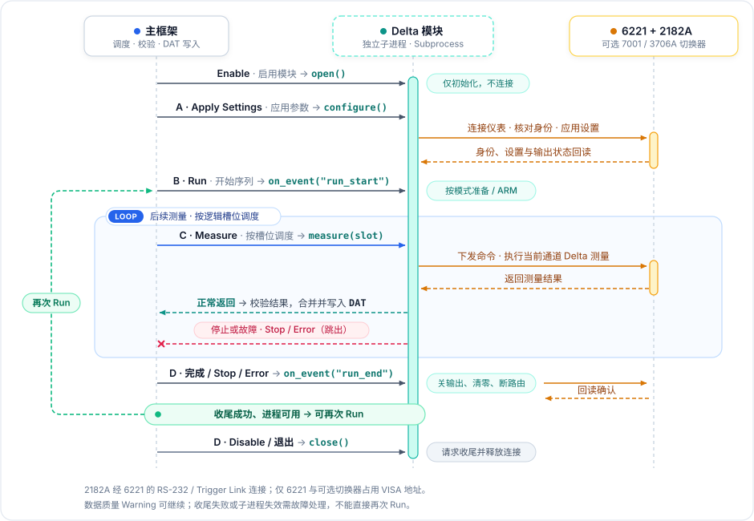
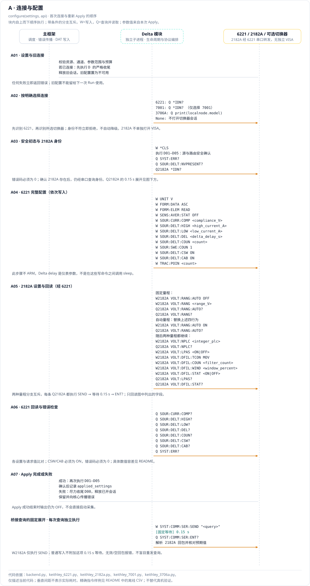
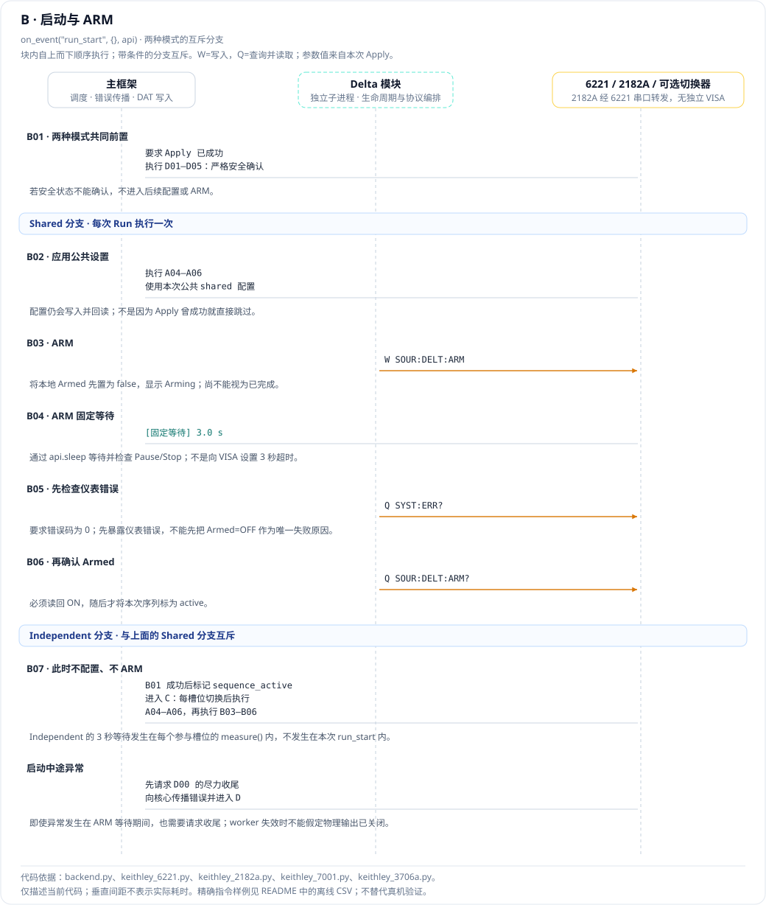
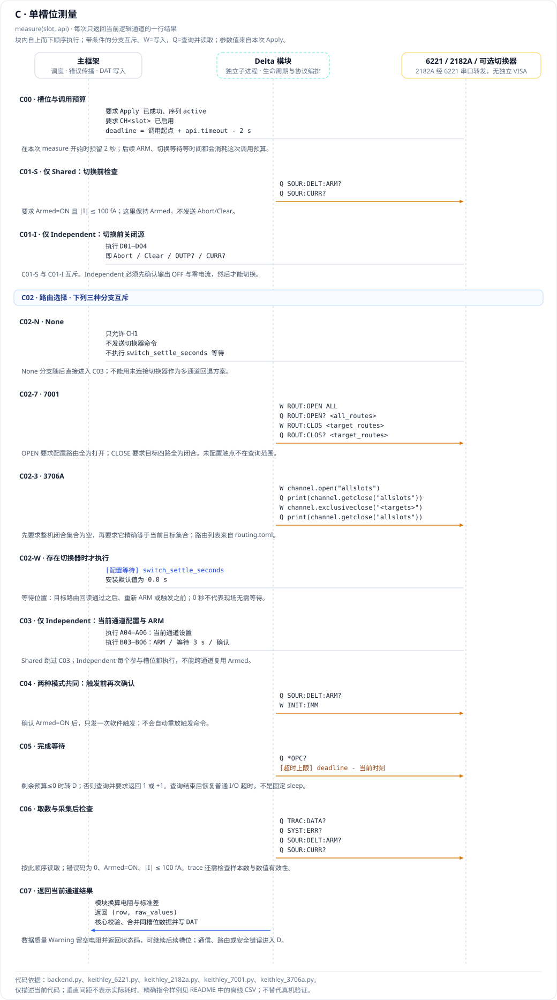
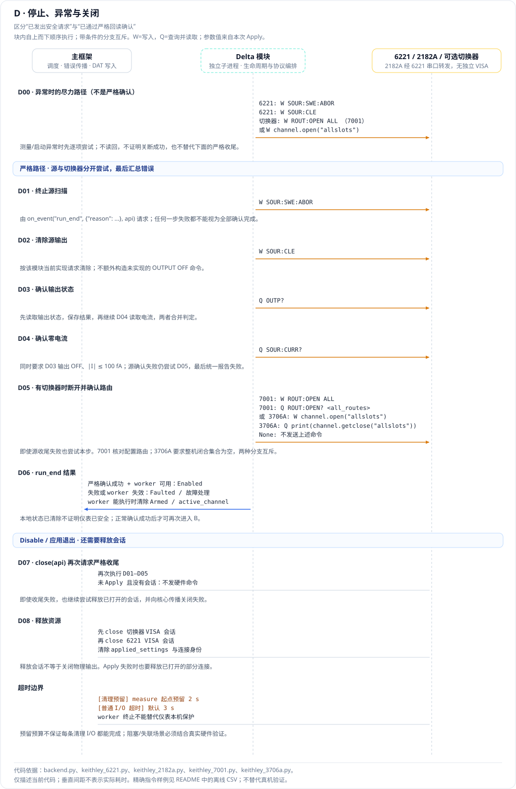

# Keithley 6221 + 2182A Delta

版本 `0.2.0b6`。本模块用 Keithley 6221 电流源和通过其 RS-232/Trigger Link
连接的 2182A 纳伏表执行 Delta 测量，并可明确选择以下通道路由方式：

- `None`：不连接切换器，只允许 CH1；
- `Keithley 7001`：通过第二个 GPIB 地址控制 7001；
- `Keithley 3706A`：通过第二个 GPIB 地址控制 3706/3706A。

模块不会自动探测或在连接失败时静默降级。选择 7001 或 3706A 后，Apply 必须识别
对应型号，否则立即报告 Error。选择 None 时完全不打开切换器 VISA 会话。
两个下拉框保存的是仪表扫描器确认过的 Measurement 资源 ID，而不是原始 GPIB
地址；模块从核心解析地址，因此不会看到或占用 System Instrument 的通讯口。

首次默认使用 Shared / stay Armed、切换器 None、仅启用 CH1，I/O timeout 为 3 秒，
切换等待为 0 秒。测量参数为高/低电流 `1m`/`-1m` A、compliance 1 V、Delta delay
`100m` 秒、count 10、2182A 量程 10 mV、积分 1 PLC；模拟及数字滤波均关闭，数字滤波
保留 Moving、count 10、window 0.010%。独立通道使用同一套初始参数。已有保存设置仍按
原值加载，Enable 不会自动应用或打开输出。

2182A 不使用独立 VISA 地址。使用前应在仪表面板上把 2182A RS-232 设置为
19.2 kbaud、XON/XOFF 和 CR 终止，并让 6221 串口设置一致，同时连接 RS-232 与
Trigger Link。模块会验证 6221 报告 2182A 存在，并通过串口转发检查 2182A 身份；
不会擅自修改这些面板通信设置。每次向 2182A 发送查询后固定等待 `0.15 s` 再读取
6221 串口缓冲；真机确认的最低等待时间为 `0.12 s`。

6221 和切换器的 GPIB 会话不附加或依赖 `\n` 文本终止符；写入使用 GPIB EOI，
读取也等待 GPIB END/EOI。

## 运行总图与指令分图

总图用于定位阶段，A—D 分图用于检查指令顺序、等待位置、回读条件和失败去向。
图中描述的是当前代码行为；箭头的垂直间距只表示先后顺序，不表示实际耗时。
`W` 表示写入，`Q` 表示查询并读取返回，参数名表示本次 Apply 的设置。

| 入口 | 分图 | 检查重点 |
| --- | --- | --- |
| A | [连接与配置](#a连接与配置) | 连接归属、身份确认、6221/2182A 设置与回读 |
| B | [启动与 ARM](#b启动与-arm) | Shared/Independent 分支、ARM 后 3 秒等待和确认顺序 |
| C | [单槽位测量](#c单槽位测量) | 零电流检查、两种切换器、切换等待、触发与取数 |
| D | [停止、异常与关闭](#d停止异常与关闭) | 尽力收尾与严格确认、Faulted、会话释放 |

### 时间标记

| 标记 | 数值或来源 | 含义 |
| --- | --- | --- |
| 固定等待 | ARM 后 `3.0 s` | Shared 每次 Run 一次；Independent 每个参与槽位一次。等待后先查 `SYST:ERR?`，再查 `SOUR:DELT:ARM?`。 |
| 固定等待 | 2182A 每条查询 `0.15 s` | `SER:SEND` 发出查询后、`SER:ENT?` 读缓冲前；普通串口写入不增加这项等待。 |
| 配置等待 | `switch_settle_seconds`，默认 `0.0 s` | 存在切换器时，在目标路由回读确认后等待；None 分支直接跳过路由与这项等待。 |
| 仪表参数 | `delta_delay`，默认 `0.1 s`；`nplc`，默认 `1 PLC` | 写入仪表的采集参数，不是 Python 命令间 sleep；PLC 对应的实际秒数取决于电网频率。 |
| I/O 超时 | `io_timeout_seconds`，默认 `3.0 s` | 普通 VISA 操作的等待上限，不是命令之间的最小间隔。 |
| 调用预算 | 核心传入的 `api.timeout` | 每次生命周期调用各自计时；`measure()` 起点预留 `2.0 s`，`*OPC?` 使用扣除已耗时后的剩余预算。 |

`api.sleep(0)` 是 Pause/Stop 检查点，不表示强制等待某个正时长；经 `_write_6221`、
`_query_6221` 和切换器读写包装的 I/O 前后也有检查点。阻塞中的第三方 I/O 不能靠检查点
立即打断。未标注固定等待的位置，代码没有
额外插入统一命令间隔，实际 I/O 耗时仍由驱动、总线和仪表决定。

### A：连接与配置

按 A01—A07 顺序执行。A04—A06 构成一套完整配置，供 B 的 Shared 启动和 C 的
Independent 单槽位测量复用。重新 Apply 时，先按旧配置执行 D 的严格收尾并释放旧会话，
再连接新地址；首次 Apply 没有这段旧会话清理。

图中的 `W2182A(command)` 是 `W SYST:COMM:SER:SEND "command"`；`Q2182A(query)`
完整展开为 **SEND 查询 → 固定等待 0.15 秒 → Q `SYST:COMM:SER:ENT?` → 解析并校验**。
所有箭头仍通过 6221 的 VISA 会话，2182A 不另开连接。

6221 浮点设置回读采用 `rel_tol=1e-8`、`abs_tol=max(1e-15, abs(expected)*1e-8)`；
count 回读采用 `rel_tol=0`、`abs_tol=1e-9`。2182A 固定量程回读采用
`rel_tol=1e-6`、`abs_tol=1e-12`，NPLC 回读采用 `rel_tol=0`、`abs_tol=1e-9`。
模拟/数字滤波开关有回读校验；滤波类型、次数和窗口目前只写入，没有逐项回读。

### B：启动与 ARM

框架发送的是 `on_event("run_start", {}, api)`。两种模式都先确认源和路由的安全初态。
Shared 随后重新执行 A04—A06 的公共配置，并完成 B03—B06 的 ARM 序列；
Independent 此时不 ARM，等 C 中当前通道切换并配置完成后再执行 B03—B06。
错误码必须先通过检查，再接受 Armed 状态，不能只看固定等待已经结束。

### C：单槽位测量

每次 `measure(slot, api)` 只处理当前启用通道。Shared 在切换前检查 Armed 和零电流；
Independent 先 Abort/Clear 并确认输出 OFF、零电流，再切换路由、重新配置和 ARM。
两种模式最后都在 `INIT:IMM` 前再次检查 Armed。

7001 的 OPEN 回读覆盖 `routing.toml` 的 `all_routes`，CLOSE 回读覆盖当前目标四路；
未配置的其他触点不在这两次查询范围。3706A 则查询 `allslots` 的闭合集合，要求先为空、
后精确等于目标集合。路由回读失败时不会继续触发，也不自动重发写命令。

取数顺序为 `*OPC?` → `TRAC:DATA?` → `SYST:ERR?` → Armed → 零电流。
有效 trace 按有效反转电流换算电阻，并返回当前通道的一行数据与 rawdata；
框架负责校验、合并同槽位模块结果并写 DAT。数据质量 Warning 省略无效电阻值、保留
状态码后继续；通信、配置、路由或安全状态错误转入 D。

### D：停止、异常与关闭

`completed`、`stopped`、`error` 都通过 `on_event("run_end", {"reason": ...}, api)`
请求相同的严格收尾。只有严格确认成功且 worker 仍可用，才回到可再次 Run 的 Enabled
状态；失败进入 Faulted，不能仅凭本地 Armed 标记已清除就认定物理输出安全。

测量/启动异常时先尽力发送 Abort、Clear 和打开路由，随后仍需要严格确认。该尽力路径
不读取状态，也不证明关断成功。严格路径分别尝试源安全确认和切换器断开确认；即使源
收尾失败，仍尝试断开并确认切换器，最后汇总错误。任一部分失败都不能视为全部确认成功。
Disable/退出还会再次收尾，然后先释放切换器会话、再释放 6221 会话。未 Apply、尚无会话
时，收尾不发送硬件命令。

`2.0 s` 是测量预算中的清理预留，不是收尾完成时限的保证；普通 I/O 默认超时仍为
`3.0 s`。worker 超时后被终止只表示本机资源回收，不代表仪表输出已经关闭。

### 对照指令表与验证范围

下表是实际模块代码在既有假通讯对象上生成的完整顺序记录，包含 CH1、CH2、Apply、
Run、逐槽位测量、正常 run_end 和 Disable。记录保留实际指令文本与显式等待；
`query_timeout_seconds` 记录查询的超时覆盖值，空值表示使用会话默认值，**不是实测耗时**。

| 切换器 | Shared | Independent |
| --- | --- | --- |
| 7001 | [完整指令表](docs/traces/7001-shared-commands.csv) | [完整指令表](docs/traces/7001-independent-commands.csv) |
| 3706A | [完整指令表](docs/traces/3706a-shared-commands.csv) | [完整指令表](docs/traces/3706a-independent-commands.csv) |

这些表采用测试夹具参数：CH1/CH2 启用，Shared 为 ±10 µA，Independent 的 CH2 为
±20 µA，count=2，Delta delay=0.1 s，1 PLC，I/O timeout=3 s，切换等待=0 s，
核心调用预算=300 s。它们不是安装默认参数或现场配置，表内 wait 表示代码请求的等待，
没有执行真实硬件计时。

本次图样核对（2026-11-28）的 48 项既有 Delta 离线测试全部通过；四组轨迹中还核对了 54 次
“串口查询 → 0.15 s → ENT?”和 6 次“ARM → 3 s → 错误查询 → Armed 查询”的顺序。
对应测试为 [7001 分支](../../tests/test_keithley_6221_2182a_delta.py)和
[3706A 分支](../../tests/test_keithley_6221_2182a_delta_3706a.py)。
四组指令表的命令与等待顺序也已与核对时的 main 实现逐条比对一致。
这些结果验证已覆盖的代码路径，不替代手册逐条核对或真机接线、时间与故障收尾验证。

## 两种运行模式

- Shared configuration / stay Armed：`run_start` 写入公共配置、发送 ARM、等待至少
  3 秒并读回确认。整个 SEQ 保持 Armed，每个逻辑槽位只切换路由并软件触发一次。
- Independent configuration / re-arm each channel：每次切换前 Abort/Clear 并确认
  零电流和输出关闭；切换后写入该通道完整配置，再 ARM、等待 3 秒、确认并触发。

动态 `slots` 让核心为每个 Enabled 逻辑通道调用一次 `measure(slot, api)`，因此
CH1-CH4 各占一行，并与其他四槽位扫描模块按槽位对齐。2182A 原始电压序列逐行写入
`rawdata`，与正式 DAT 行一一对应。Delta count 最大 32,768，以保证 IPC 帧有界。

Status 中 `Connected Channel` 表示当前连接的逻辑通道；`Last Measured Channel` 表示
下面一组 Last Resistance、Last Current 和 Last StdDev 所属的最近完成测量通道。
切换通道时保留上一组结果及其通道标记，直到新测量完成；数据无效时电阻和标准差显示 `-`。
输出关闭、路由断开后连接通道显示 `-`，最后测量结果仍保留。

## 路由配置

物理接线只保存在 `routing.toml`，界面不显示具体触点。文件同时包含：

- `[switchers.7001.channels]`：7001 完整 Channel List 地址；
- `[switchers.3706a.channels]`：3706A 四位全局通道号。

安装的卡型、槽位或接线变化时，修改对应分区并重启程序。模块不接受旧的单
`[channels]` 格式，也不猜测卡型。每次触发前执行 break-before-make：先请求打开全部
触点并读回，再闭合目标四路。7001 核对配置路由的 OPEN 和目标四路的 CLOSE 状态；
3706A 核对整机闭合集合精确匹配。运行中的任何路由通信
或读回错误都会终止 SEQ；写结果不确定时不会自动重发。

## 数据状态与安全边界

每个逻辑通道只写自己的 `Delta_Rn(ohm)` 和 `Delta_Rn_StdDev(ohm)`，其余通道列
留空；四个通道共用一个 `Delta_Current` 列，并各自在 `Delta_StatusCode` 中写入以下
数值：

- `0`：正常；
- `1`：有限 2182A 电压超出支持量程；
- `2`：预留给经过真机确认的 6221 compliance 事件；
- `3`：Delta trace 无效、非有限或样本数不完整。

状态非零时当前通道的 `Delta_Rn(ohm)` 和 `Delta_Rn_StdDev(ohm)` 留空。数据质量
问题调用去重 Warning 并继续 SEQ；通信、身份、配置读回、路由、触发状态或安全输出
无法确认时报告 Error 并终止。

Apply 在身份确认后先用 `*CLS` 清除 6221 跨会话保留的历史错误，再执行
Abort/Clear、确认输出关闭及零电流，并在存在切换器时打开全部触点。Apply 结束、
Stop、Error、Disable 和正常 SEQ 结束也执行相同的安全关闭。模块没有单通道
timeout，也没有 DUT 软件电流/compliance 上限；长 `*OPC?` 使用核心 Measure 总预算
并预留安全清理时间。仍会
按 6221 手册拒绝仪表自身不支持的命令范围，但这不等于样品安全认证。

本版本尚未用真实仪表、开关卡、DUT、线缆和 GPIB 控制器验证，仍按 Beta 使用。

## 代码边界

- `backend.py`：生命周期、槽位调度、超时、报警与安全清理；
- `keithley_6221.py`：6221 VISA 与 Delta SCPI；
- `keithley_2182a.py`：2182A 串口命令和 trace 解析；
- `keithley_7001.py`：7001 路由协议；
- `keithley_3706a.py`：3706A TSP 路由协议；
- `frontend.py`：设置与状态界面；
- `routing.py` / `routing.toml`：隐藏物理路由的读取和校验。

## 底层通讯参考

- [PyMeasure 6221 源码](https://github.com/pymeasure/pymeasure/blob/master/pymeasure/instruments/keithley/keithley6221.py)：Delta 的 ARM、触发、停止和读取 6221 缓冲区。
- [QCoDeS 社区 2182A 源码](https://qcodes.github.io/Qcodes_contrib_drivers/_modules/qcodes_contrib_drivers/drivers/Tektronix/Keithley_2182A.html)：核对量程、NPLC 和滤波命令；其驱动直接连接 2182A，不包含经 6221 的串口转发。
- [6221 厂商手册](https://download.tek.com/manual/622x-900-01%28B-Jun2005%29%28User%29.pdf)：串口转发是先 `SEND`，再用 `ENT?` 取回回复。Apply 时回空表示这一查询没有取到回包，不是 2182A 回报了错误的量程或 NPLC 值。
- [QCoDeS 3706A 源码](https://github.com/microsoft/Qcodes/blob/main/src/qcodes/instrument_drivers/Keithley/Keithley_3706A.py)与 [3700A 厂商手册](https://download.tek.com/manual/3700AS-901-01D_Jul_2018_Ref_0.pdf)：`channel.getclose` 的 `nil` 表示无闭合通道；多通道回包按厂商手册用逗号解析。7001 是不同的 SCPI 协议，参考 [7001 厂商手册](https://download.tek.com/manual/7001_901_01H.pdf)。
